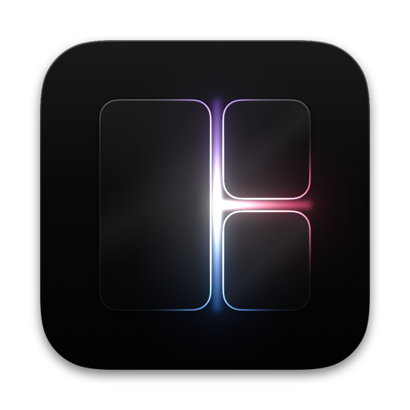

<p align="center">
  
</p>

<h1 align="center">Panespace</h1>

<p align="center">
  An i3-style tiling window manager for macOS.<br>
  Your i3 config, instant workspaces, and nothing to disable: no SIP changes, no Dock injection.
</p>

<p align="center">
  <a href="https://github.com/broisnischal/panespace/releases/latest">Download</a> ·
  <a href="#install">Install</a> ·
  <a href="#keys">Keys</a> ·
  <a href="#configuration">Configuration</a>
</p>

## Features

- **i3 layouts.** Horizontal and vertical splits, tabbed and stacking containers, and i3's `move` rules.
- **Instant workspaces.** Panespace keeps its own workspaces, separate from macOS Spaces. Switching has no animation.
- **i3 config syntax.** `bindsym`, modes, `for_window` / `assign` rules, gaps, scratchpad, `back_and_forth`.
- **Mouse.** Drag the edge between two windows and both resize live. Drop a window on another to swap them. Double-click a title bar to zoom that window to the full screen; double-click again to put it back.
- **Animations.** Windows glide when the layout changes: opening and closing, moving and swapping, resizing, and switching workspaces, which slide like macOS Spaces. Turn them off with `animations no`.
- **Menu bar.** Shows the current workspace. Its menu switches workspaces, floats or fullscreens the focused window, changes the layout, and edits settings.
- **Immersive mode.** Auto-hides the macOS menu bar, so windows fill the whole display. The Dock is left to its own macOS setting.
- **Multi-monitor.** Move focus, windows and whole workspaces between displays.
- **CLI.** `panespace msg …` works like `i3-msg`.

## Install

Download `Panespace-<version>.zip` from [Releases](https://github.com/broisnischal/panespace/releases), unzip it into `~/Applications` and open it. The app isn't notarized, so the first time, right-click it and choose **Open**.

Or build it from source (needs Xcode or the Swift toolchain):

```sh
make install       # Panespace.app + Caps.app in ~/Applications, CLIs in ~/.local/bin
make login-item    # start at login
```

On first launch, allow Panespace in **System Settings → Privacy & Security → Accessibility**.

Before you start:
- Quit other window managers (AeroSpace, yabai, Amethyst) and turn off Rectangle's drag-to-snap.
- Use one macOS Space per display. Panespace can't see windows on other Spaces.

## Keys

`$mod` is ⌃⌥ by default. Change it with `set $mod caps | alt | cmd | hyper`, or from the menu bar.

| Keys | Action |
|---|---|
| `$mod+h/j/k/l` or arrows | Focus left / down / up / right |
| `$mod+Shift+h/j/k/l` | Move the window |
| `$mod+1…0` | Switch to workspace 1…10 |
| `$mod+Shift+1…0` | Move the window to a workspace |
| `$mod+b` / `$mod+v` | Split horizontally / vertically |
| `$mod+w` / `$mod+s` / `$mod+e` | Tabbed / stacking / toggle split |
| `$mod+f` / `$mod+Shift+f` | Fullscreen / immersive mode |
| `$mod+Shift+space` | Float or tile the window |
| `$mod+r` | Resize mode: `hjkl` or arrows, `b` to balance, Esc to leave |
| `$mod+Shift+q` | Close the window |
| `$mod+Shift+c` / `$mod+Shift+e` | Reload the config / quit |

## Configuration

Panespace writes a commented default config to `~/.config/panespace/config` on first run. Edit it from the menu bar (**Settings → Edit Config…**) and reload with `$mod+Shift+c`.

```
set $mod ctrl+alt
bindsym $mod+Return exec open -na Ghostty

gaps inner 8
smart_gaps on
focus_follows_mouse no
animations yes                     # animation_duration 180 (ms)
workspace_indicator number         # menu bar: number | pill | panes | circle | minimal | segmented | dots | tiles
floating_modifier $mod             # $mod+drag moves, $mod+right-drag resizes

workspace 9 output secondary
assign [app="^Slack$"] → 9
for_window [app="^System Settings$"] floating enable
```

Run `panespace check-config` to find mistakes, and `panespace list-windows` to see the app names and titles your rules can match.

## CLI

```sh
panespace msg workspace 3
panespace msg '[app="Safari"] focus'
panespace msg -t get_tree        # get_workspaces, get_config, get_version, …
```

## Caps

`Caps.app` is an optional companion app that makes Caps Lock a programmable key. Hold Caps and press a key to open an app, send a shortcut or run a script, set per app in `~/.config/caps/config`. Keys you don't bind pass through to Panespace.

## How it works

- Panespace uses the Accessibility API only. Windows on hidden workspaces are moved to the corner of the screen, so switching workspaces is a single move per window.
- Animations write every frame to all windows together, one thread per app, and take their timing from the clock: a slow app drops frames but never delays the layout. A new change interrupts a running animation and carries on from where each window is.
- The layout tree, config parser and command engine are a plain Swift module (`PanespaceCore`) with unit tests.
- The main thread never waits on another app. Window moves run on background queues, one thread per app, so one frozen app can't stall the rest.
- If an app won't shrink below a minimum size, its neighbours make room instead of overlapping it.

## Limitations

- Windows on other macOS Spaces, and windows in native macOS fullscreen, can't be tiled.
- Floating windows aren't kept above tiled ones.
- Not yet supported: `resize set`, marks, `sticky`, title bars.

## Development

```sh
make test     # unit tests
make app      # build and sign the apps
make icon     # regenerate the app icon from scripts/make-icon.swift
```
